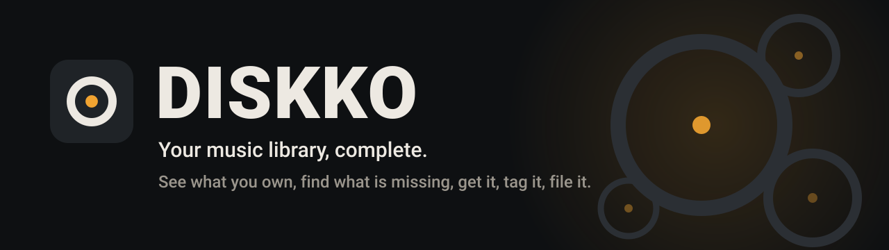
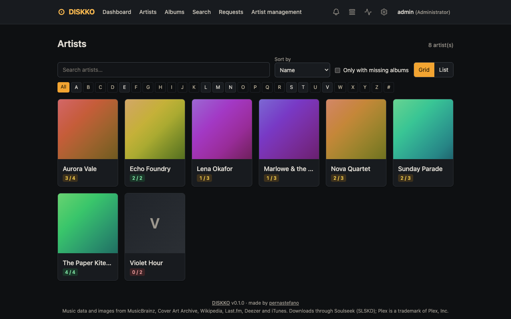
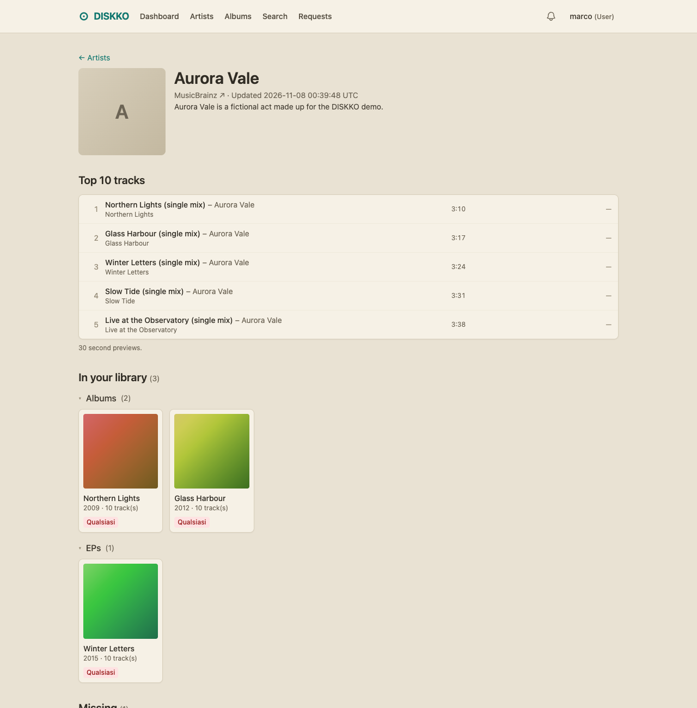
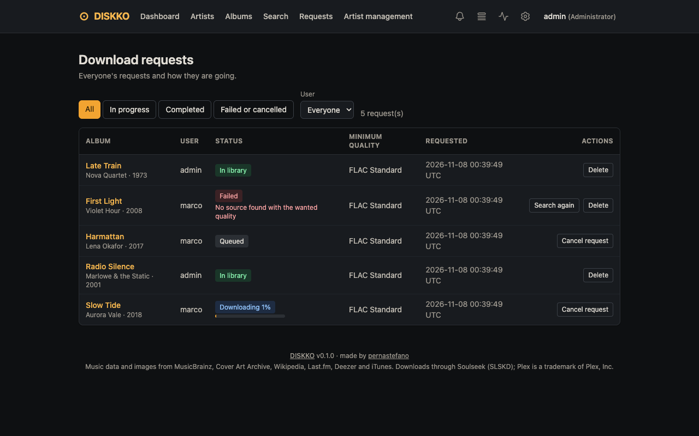
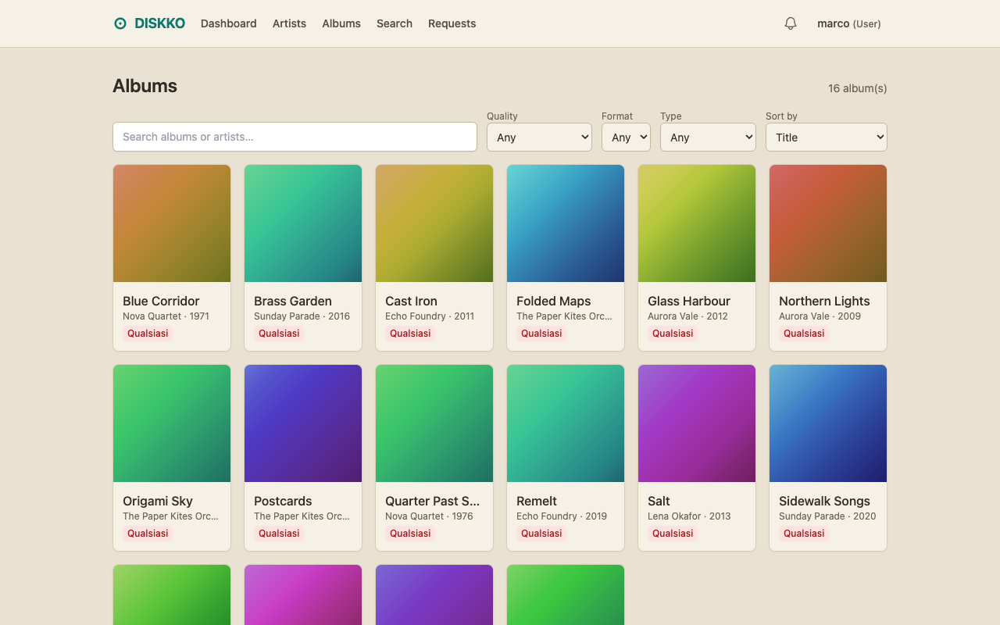

<p align="center">
  
</p>

<p align="center">
  <a href="https://github.com/pernastefano/diskko/actions/workflows/docker.yml"></a>
  
  
  <a href="LICENSE"></a>
</p>

<p align="center">
  <strong>Which albums of your favorite artists are you missing?</strong><br>
  DISKKO reads your music library (a folder or Plex), shows what you own and what is missing,<br>
  and gets the rest through SLSKD: found, downloaded, tagged, filed and handed back to Plex.
</p>

<p align="center">
  
  
</p>
<p align="center">
  
  
</p>
<p align="center"><sub>Screenshots of the demo library (fictional artists), in the Graphite and Sand themes.</sub></p>

## Contents

[Why DISKKO](#why-diskko) · [How it works](#how-it-works) · [Features](#features) · [Quick start](#quick-start) · [Configuration](#configuration) · [Good to know](#good-to-know) · [Documentation](#documentation) · [Built with](#built-with) · [Contributing](#contributing)

## Why DISKKO

- **Know what is missing.** Every artist card reads *owned / total albums*, from MusicBrainz, so a glance tells you which discographies are complete.
- **From wish to library in one click.** Request an album and DISKKO searches SLSKD, picks the best source for the quality you want, follows the download, tags the files, moves them into the library and tells Plex.
- **Safe with your files.** Nothing in the library is ever overwritten: a download that cannot be imported goes to quarantine with the reason, and every move is atomic.
- **Shared, not mixed.** Several people can use one installation. The library is shared; requests, notifications and preferences are per user, and administrators see everything (with an audit log).
- **Yours.** One SQLite file on your own server. No analytics and no accounts elsewhere; the only third-party requests from your browser are the interface libraries (see *Good to know*). Sign-in is rate-limited and the database is backed up every night.
- **Simple to run.** One container (amd64 and arm64, so a NAS is fine) plus the SLSKD you probably already have. English and Italian interface, light (Sand) and dark (Graphite) themes.

## How it works

Everything slow or external is a **job** that you can follow in real time in the admin pages: scanning, MusicBrainz, SLSKD, tagging, Plex.

| Step | What happens |
|------|--------------|
| **Scan** | Your folder (tags read with mutagen) or your Plex music library is read into DISKKO's index. The source you choose is the one that counts. |
| **Match** | Artists and albums are matched to MusicBrainz release groups (Deezer fills the gaps MusicBrainz leaves). Doubtful matches wait in a review queue. |
| **Request** | An album you miss, or an upgrade to a better quality, is requested from its artist page. |
| **Download** | SLSKD is searched, candidates are scored against the quality profile, the best one is downloaded (or you choose). |
| **Import** | Files are checked, tagged from MusicBrainz, cover art embedded, named from a template, moved atomically into the library. |
| **Rescan** | Plex is asked to scan the new folder (the whole music section if it has to), and the album leaves the "missing" list. |

## Features

**Library**
- Artists as a grid or a list, with search, an A–Z bar and *only with missing albums*; albums with filters for audio quality, format and type.
- Artist page: picture, a short biography (Wikipedia, Last.fm as fallback), top 10 tracks with 30-second previews, owned and missing albums by type.
- Album page: track table with a player for owned files and previews for the others; refresh metadata, fix the match, request a quality upgrade.
- Configurable quality profiles, from *FLAC Master* (24-bit / 192 kHz) to *Any*.

**Downloads**
- Per-user requests with status, progress and actions (cancel, search again, delete finished ones).
- Automatic or manual choice of the source; stalled, offline or queued-forever sources are skipped.
- Import with tagging, embedded and `cover.jpg` artwork, naming templates and quarantine; upgrades keep the old copy aside.

**Discovery**
- Search any artist on MusicBrainz, similar artists (Last.fm, ListenBrainz), previews (iTunes, Deezer).
- Metadata, cover, preview and discovery services have fallbacks and a circuit breaker; every service has a status light.

**Administration**
- Jobs with live logs, cancel and retry; service status; audit log; database backups with download.
- Users with roles, in-app notifications, English and Italian.

## Quick start

### With Docker Compose

The image is built by GitHub Actions and published to the GitHub Container Registry. Save this as `docker-compose.yml` next to a `.env` file (see [`.env.example`](.env.example)):

```yaml
services:
  diskko:
    image: ghcr.io/pernastefano/diskko:latest
    restart: unless-stopped
    ports: ["8000:8000"]
    env_file: .env
    environment:
      PUID: 1000                     # the owner of your music folder
      PGID: 1000
      PORT: "8000"
      DATA_DIR: /data
      MUSIC_DIR: /music
      DOWNLOADS_DIR: /downloads
    volumes:
      - ./data:/data                 # database, covers, backups
      - /path/to/music:/music
      - /path/to/slskd-downloads:/downloads   # the same folder SLSKD downloads into
```

```bash
cp .env.example .env     # then set SECRET_KEY (python3 -c "import secrets; print(secrets.token_urlsafe(48))")
docker compose up -d
```

Open http://localhost:8000: the first visit asks you to create the administrator. Then set Plex, SLSKD and your MusicBrainz contact under **Settings → Integrations**. SLSKD also needs a Soulseek account and an API key: see [Set up SLSKD](docs/DEPLOYMENT.md#volumes-and-paths). Put it behind HTTPS before exposing it: [docs/DEPLOYMENT.md](docs/DEPLOYMENT.md) has the full Compose file with SLSKD, a reverse proxy, backups and upgrades.

### From source

Requires Python 3.12.

```bash
git clone https://github.com/pernastefano/diskko.git && cd diskko
make install            # creates .venv and installs the dependencies
make run                # http://localhost:8080
```

`GET /health` returns `{"status": "ok"}` once the app and its database are up.

## Configuration

Configuration is read from environment variables (and a `.env` file in development). Most of it can also be changed by an administrator in **Settings**, which wins over the environment. The essentials:

| Variable | Default | Description |
|----------|---------|-------------|
| `SECRET_KEY` | `change-me` | Signs session cookies. **Required** in production (the app refuses to start with the default when `BASE_URL` is https or `ENV=production`). |
| `PORT` | `8000` in the image, `8080` in `.env.example` | Port the app listens on. The Compose file sets it to 8000. |
| `BASE_URL` | `http://localhost:8080` | The address people use. An `https://` address makes cookies `Secure`. |
| `PUID` / `PGID` | `1000` | User and group the container runs as (the owner of your music and downloads). |
| `DATA_DIR` | `./data` (`/data` in the image) | Database, covers and backups. Keep it on a volume. |
| `MUSIC_DIR` | `./music-test` (`/music`) | Your library (scanned and imported into). |
| `DOWNLOADS_DIR` | `./downloads-test` (`/downloads`) | Where SLSKD saves; must be the same folder SLSKD sees. |
| `LIBRARY_SOURCE` | `filesystem` | `filesystem` or `plex`. |
| `PLEX_URL` / `PLEX_TOKEN` | | Plex server and token (library source and rescans). |
| `SLSKD_URL` / `SLSKD_API_KEY` | | SLSKD address and an API key that is not read-only (the slskd main key is `Administrator`). |
| `MB_USER_AGENT` | | Required by MusicBrainz: `App/1.0 ( you@example.com )`. |
| `LASTFM_API_KEY` | | Optional: similar artists and biographies. |
| `LOG_FORMAT` | `text` (`json` in the image) | `json` prints one object per line; secrets are always scrubbed. |
| `LOGIN_MAX_ATTEMPTS` | `5` | Failed sign-ins per account within `LOGIN_WINDOW_SECONDS` (300) before it pauses. |
| `TRUST_PROXY` | `false` | Read `X-Forwarded-For` for the sign-in limit. Only behind a proxy you control. |
| `BACKUP_CRON` / `BACKUP_KEEP` | `15 3 * * *` / `7` | Nightly database backup and how many copies to keep. |

[`.env.example`](.env.example) lists the common ones, and [docs/DEPLOYMENT.md](docs/DEPLOYMENT.md#configuration-reference) explains them.

## Good to know

- **One process only.** Run a single Uvicorn process (no `--workers N`): the job worker and scheduler live in it.
- **Paths must agree.** DISKKO and SLSKD must see the downloads folder, and DISKKO and Plex the music folder, at paths you can map (`LIBRARY_PATH_MAP` translates Plex's view into yours).
- **Quality is read, not guessed.** DISKKO trusts codec, bit depth, sample rate and bitrate. It does not analyze spectra, so a FLAC made from an MP3 looks like a FLAC.
- **Back up `/data`.** It holds the database, including the saved Plex token and API keys: store backups as carefully as the database. Restore steps are in the [deployment guide](docs/DEPLOYMENT.md#backups-and-restore).
- **Plex and the library source.** After an import Plex scans the album's folder; if it refuses or does not show the album, DISKKO scans the whole music section once. A scan that would remove more than half the known tracks stops (an unmounted folder).
- **Respect the services.** MusicBrainz is limited to one request per second (built in), and Last.fm and Deezer allow non-commercial use only.
- **The interface needs internet access in your browser.** Tailwind CSS, HTMX and Alpine.js are loaded from public CDNs (`cdn.tailwindcss.com`, `unpkg.com`, `cdn.jsdelivr.net`); without them the page is unstyled and does not respond to clicks. Your music data never goes there.
- **No password recovery by email.** An administrator can reset any user's password.

## Documentation

| Document | Contents |
|----------|----------|
| [docs/USER_GUIDE.md](docs/USER_GUIDE.md) | First run, the library, requesting albums, quality profiles, notifications, settings, troubleshooting. |
| [docs/DEPLOYMENT.md](docs/DEPLOYMENT.md) | Container, PUID/PGID, volumes, SLSKD and Plex, HTTPS and reverse proxy, backups, upgrades, hardening. |
| [docs/DEVELOPMENT.md](docs/DEVELOPMENT.md) | Setup, commands, project layout, tests, the end-to-end stack, CI and releasing. |

## Built with

Python 3.12 · FastAPI · SQLAlchemy 2 · Alembic · SQLite (WAL) · Jinja2 · HTMX · Alpine.js · Tailwind CSS · httpx · mutagen · rapidfuzz · python-plexapi · APScheduler · pytest · ruff.

## Contributing

Contributions are welcome. Before opening a pull request:

```bash
ruff check . && ruff format .   # lint + format
pytest -q                       # run the tests
```

Every feature comes with tests and every schema change with an Alembic migration. See [docs/DEVELOPMENT.md](docs/DEVELOPMENT.md).

## Credits

Music metadata from [MusicBrainz](https://musicbrainz.org) (CC0), artwork from the [Cover Art Archive](https://coverartarchive.org), [Wikipedia](https://www.wikipedia.org), [Last.fm](https://www.last.fm) and [Deezer](https://www.deezer.com), previews from iTunes and Deezer. Downloads go through [slskd](https://github.com/slskd/slskd). Plex is a trademark of Plex, Inc.

## License

MIT, see [LICENSE](LICENSE). Created by [Stefano Perna](https://github.com/pernastefano).
